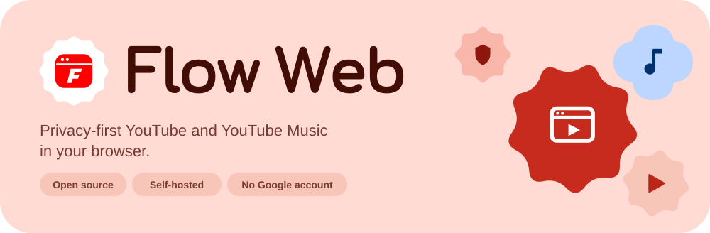

<div align="center">
  <picture>
    <source media="(prefers-color-scheme: dark)" srcset="Assets/web/banner-dark.svg">
    
  </picture>

  **A privacy-respecting YouTube and YouTube Music client, right in your browser.**

  Flow Web is an unofficial browser-based edition of [Flow Desktop](https://github.com/Flow-Tube/Flow-Desktop), designed for self-hosting and built with Rust, React, and TypeScript.

  <p>
  <a href="#installation"><picture><source media="(prefers-color-scheme: dark)" srcset="Assets/web/install-dark.svg"></picture></a>
  <a href="#docker--podman"><picture><source media="(prefers-color-scheme: dark)" srcset="Assets/web/server-dark.svg"></picture></a>
  <a href="#development"><picture><source media="(prefers-color-scheme: dark)" srcset="Assets/web/source-dark.svg"></picture></a>
  </p>
  <p>
  <a href="#installation"><picture><source media="(prefers-color-scheme: dark)" srcset="Assets/web/platform-dark.svg"></picture></a>
  <picture><source media="(prefers-color-scheme: dark)" srcset="Assets/web/stack-dark.svg"></picture>
  <a href="LICENSE"><picture><source media="(prefers-color-scheme: dark)" srcset="Assets/web/license-dark.svg"></picture></a>
  </p>

  [**Installation**](#installation) · [**Features**](#features) · [**Original Flow**](#the-flow-project) · [**Support development**](#support--donations)
</div>

> Flow Web is under active development. Browser compatibility and some features are still being tested.

---

## Features

- **Video:** YouTube search, playback with quality and codec selection, DASH, SABR, HLS, chapters, subtitles, playback speed, queues and Picture-in-Picture.
- **YouTube Music:** home, search, artists, albums, playlists, queues and lyrics.
- **Shorts:** a dedicated feed with descriptions and comments.
- **Library:** subscriptions, playlists, likes, Watch Later, watch history and Explore.
- **Extensions:** SponsorBlock, DeArrow and Return YouTube Dislike.
- **Downloads:** save supported video and audio streams as files directly from the browser.
- **Self-hosting:** one server for your library, preferences and recommendations, accessible from desktop and mobile browsers.

### FlowNeuro

FlowNeuro is Flow's recommendation engine. It learns from viewing habits, searches, topic preferences and creator affinity to personalize your home feed. Flow Web runs the original Rust engine on your own server, without requiring a Google account.

See the [feature parity tracker](https://github.com/Advancefeescam/Flow-Web/blob/feat/web-runtime/docs/WEB.md#parity-tracker) for current limitations, including Flow Sync, multiple profiles, and full backup and restore.

---

## Privacy and security

- No Google account is required for ordinary use.
- Library data, history, settings and recommendation state are stored in SQLite on your instance.
- The web API and media routes require authentication.
- The server validates supported commands and media destinations; the default deployment listens on localhost.
- Compatible DASH streams can use direct browser playback, with the authenticated server relay as a fallback.

Flow Web still contacts YouTube and optional services when their features are used. Unlike the native clients, its data lives on the server rather than exclusively on the viewing device. Use an instance you operate or trust.

---

## Installation

Flow Web serves its own browser interface from a headless Rust server. No desktop application is required on the viewing device.

| Component | Target |
| --- | --- |
| Server | Linux x64 and ARM64, including home servers and NAS devices |
| Development | Linux or Windows with WSL2 |
| Client | Modern desktop and mobile browsers |
| PWA | Installable web interface; iPadOS compatibility is being tested |

The current source build is available on [`feat/web-runtime`](https://github.com/Advancefeescam/Flow-Web/tree/feat/web-runtime). Container deployment on ARM64 and full Safari compatibility are not yet verified.

### Docker / Podman

```bash
git clone --branch feat/web-runtime https://github.com/Advancefeescam/Flow-Web.git
cd Flow-Web

export FLOW_WEB_ORIGIN=http://127.0.0.1:8780
read -r -s -p "Password (at least 16 characters): " FLOW_WEB_PASSWORD; echo
export FLOW_WEB_PASSWORD

docker compose -f compose.web.yml up --build
```

For Podman, use `podman compose -f compose.web.yml up --build`.

Open [http://127.0.0.1:8780](http://127.0.0.1:8780) and sign in with the username `flow` and your chosen password. The Compose configuration keeps application data in a persistent volume.

For access from other devices, configure a trusted HTTPS reverse proxy and set `FLOW_WEB_ORIGIN` to the exact browser origin. Do not expose the development server directly to the internet or share its data volume with Flow Desktop or Flow Sync.

---

## Development

Requirements: Node.js 24, pnpm 11.9, stable Rust and the Linux build dependencies described in the [web runtime documentation](https://github.com/Advancefeescam/Flow-Web/blob/feat/web-runtime/docs/WEB.md).

Clone the web runtime branch as shown above, then run:

```bash
pnpm install --frozen-lockfile
pnpm build --mode web

export FLOW_WEB_ORIGIN=http://127.0.0.1:8780
read -r -s -p "Password (at least 16 characters): " FLOW_WEB_PASSWORD; echo
export FLOW_WEB_PASSWORD

cd web-server
cargo run --release
```

Run tests from the repository root:

```bash
pnpm test
cargo test --manifest-path web-server/Cargo.toml
```

Flow Web shares the original Flow Desktop frontend, extraction, streaming and recommendation services. A browser transport and headless backend replace the Tauri-specific communication layer. Web-specific changes are kept separate where possible to simplify updates from upstream.

- [Web runtime documentation](https://github.com/Advancefeescam/Flow-Web/blob/feat/web-runtime/docs/WEB.md)
- [Updating from Flow Desktop](https://github.com/Advancefeescam/Flow-Web/blob/feat/web-runtime/docs/WEB.md#updating-from-flow-desktop)
- [Contributing](CONTRIBUTING.md)
- [Security policy](SECURITY.md)

---

## The Flow project

Flow Web is an independent, unofficial port of Flow Desktop. Credit for the original application and FlowNeuro goes to [A-EDev](https://github.com/A-EDev) and the Flow contributors.

- [Flow for Android](https://github.com/Flow-Tube/Flow) — Android client
- [Flow Desktop](https://github.com/Flow-Tube/Flow-Desktop) — Windows, macOS and Linux
- [Flow Sync](https://github.com/Flow-Tube/Flow-Sync) — self-hosted synchronization
- [Official website](https://flow-tube.org) · [Community](https://www.reddit.com/r/Flow_Official/)

Report web-specific issues in [this repository](https://github.com/Advancefeescam/Flow-Web/issues).

---

<a id="support--donations"></a>
## Support & donations

Support the original Flow project and its independent developer, A-EDev. All donation links below go to upstream Flow development.

<a href="https://opencollective.com/flow-tube"><picture><source media="(prefers-color-scheme: dark)" srcset="https://assets.flow-tube.org/v1/badges/pill/support-opencollective-dark.svg"></picture></a>
<a href="https://patreon.com/A_EDev"><picture><source media="(prefers-color-scheme: dark)" srcset="https://assets.flow-tube.org/v1/badges/pill/support-patreon-tonal-dark.svg"></picture></a>

## License

Flow Web is free and open-source software licensed under the [GNU General Public License v3.0](LICENSE) (GPL-3.0-only).

Original Flow Desktop copyright © 2025–2026 A-EDev.

Modified for browser and server use by Flow Web contributors, November 2026.
