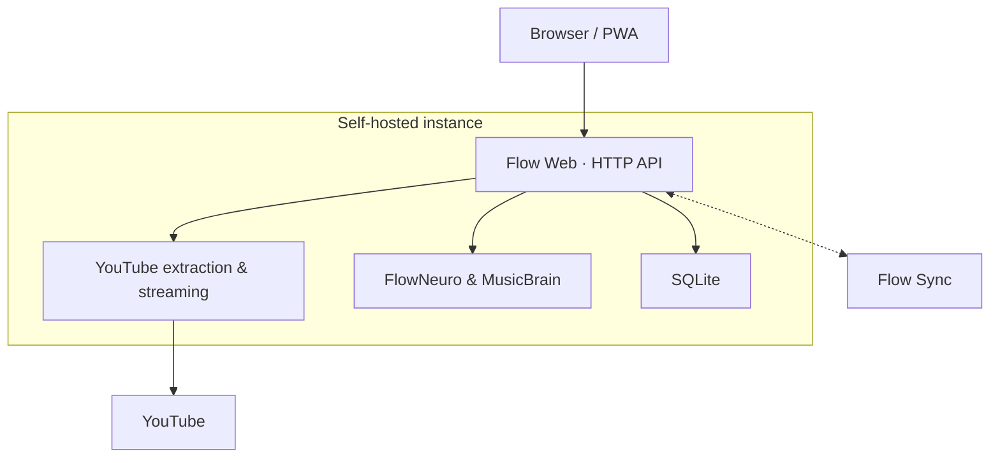

<div align="center">
  

  <h1>Flow Web</h1>

  **A privacy-respecting YouTube and YouTube Music experience, right in your browser.**

  An unofficial, self-hosted web port of [Flow Desktop](https://github.com/Flow-Tube/Flow-Desktop), bringing the Flow experience to more devices without a native app.

  <p>
    
    
    
    <a href="LICENSE"></a>
  </p>

  [**About**](#about) · [**Development**](#development) · [**Original Flow**](#the-flow-project) · [**Support Flow**](#support--donations)
</div>

> [!NOTE]
> Flow Web is an independent, unofficial fork of Flow Desktop. The web port is in early development and is not yet ready for everyday use. The original Flow applications are developed separately by the Flow project.

---

## About

Flow offers an alternative way to watch YouTube and listen to YouTube Music, with a focus on privacy, personal libraries and recommendations under your control.

Flow Web aims to bring that same experience to the browser. Whether you use an iPad, an operating system without an official Flow client, a shared computer, or simply prefer not to install another app, you should be able to open your own Flow instance and start watching.

The goal is to complement the native Flow clients, not replace them.

### Why Flow Web?

- **No client installation.** Open your instance in a browser rather than installing a platform-specific application.
- **More devices.** Bring Flow to iOS, iPadOS and other platforms where a native client may not be available.
- **Self-hosted by design.** Run your own instance on a home server, NAS or small ARM64 device.
- **A familiar experience.** Retain the original Flow interface, design language and core functionality wherever the browser allows.
- **One library, across devices.** Work towards compatibility with Flow Sync so your subscriptions, playlists, watch history and recommendations can follow you.

---

## Features

The web port aims to retain the following capabilities from Flow Desktop. These are development goals, not a list of working web features.

- Video search and playback, with quality selection, subtitles, chapters and playback speed controls.
- YouTube Music, including artists, albums, playlists, queues and lyrics.
- Shorts, channel pages, subscriptions, Explore and comments.
- Personal playlists, Watch Later, likes, history and Continue Watching.
- SponsorBlock, DeArrow and Return YouTube Dislike integrations.
- A responsive interface for phones, tablets and desktop browsers, with an optional installable PWA.

### FlowNeuro

[Flow Desktop](https://github.com/Flow-Tube/Flow-Desktop) includes FlowNeuro, a recommendation engine that learns from your viewing habits and preferences without relying on a Google account.

Flow Web aims to reuse the original Rust engine and keep recommendation processing and storage within your own instance. Compatibility with the native Flow clients and their recommendation state is a development goal.

---

## Architecture

Flow Web is based on the existing React, TypeScript and Rust codebase of Flow Desktop. The intended architecture separates the browser interface from the native desktop runtime, replacing Tauri-specific communication with an HTTP API.



The existing Rust services, streaming implementation and recommendation engines will be reused where practical. Video decoding is intended to happen in the browser rather than through server-side transcoding.

### Target platforms

| Client | Intended access |
| --- | --- |
| iOS / iPadOS | Safari, home screen web app |
| Android | Modern mobile browsers |
| Windows / macOS / Linux | Modern desktop browsers |
| Other systems | Compatible web browser |

The intended server targets are Linux on x86-64 and ARM64, including container deployments through Docker or Podman. Browser and server compatibility have not yet been validated.

---

## Privacy and security

Flow Web follows the privacy goals of the original project while adapting them to a self-hosted environment.

- No Google account should be required for ordinary use.
- Personal data and recommendation state should remain on the instance you operate or trust.
- Remote access should use HTTPS and appropriate authentication.
- Streaming and API endpoints must be designed for web security rather than exposing desktop-only interfaces directly.

A self-hosted service is not the same as a fully on-device application: the instance operator controls the server and its stored data. Flow also communicates with YouTube and optional third-party services when their features are used.

---

## Development

The repository currently contains the upstream Flow Desktop codebase. The first milestones are a browser-compatible API transport, a headless Rust backend and working video playback.

```sh
git clone https://github.com/Advancefeescam/Flow-Web.git
cd Flow-Web
pnpm install --frozen-lockfile
pnpm dev
```

The inherited frontend requires Node.js 22.12+ and pnpm 11.9+. The Vite development server is useful for inspecting the interface, but browser mode still uses upstream mock data in several places. This is not yet a functional self-hosted installation.

Production container images and deployment instructions will be added once the web backend is ready.

### Roadmap

- [ ] Browser-compatible API transport and events
- [ ] Headless Rust backend and secure media delivery
- [ ] Search, video playback and core browsing
- [ ] Personal library, FlowNeuro and MusicBrain
- [ ] Flow Sync compatibility
- [ ] Responsive iPadOS experience and PWA
- [ ] Docker and Podman deployment for x86-64 and ARM64

---

## The Flow project

Flow Web builds on the work of [A-EDev](https://github.com/A-EDev) and the original Flow contributors. It is not an official Flow release and is not affiliated with or endorsed by the upstream project.

For the native clients and the original ecosystem:

- [Flow for Android](https://github.com/Flow-Tube/Flow)
- [Flow Desktop](https://github.com/Flow-Tube/Flow-Desktop) — Windows, macOS and Linux
- [Flow Sync](https://github.com/Flow-Tube/Flow-Sync)
- [Official Flow community](https://www.reddit.com/r/Flow_Official/)

Please report issues specific to the web port in this repository, rather than in the upstream project.

---

<a id="support--donations"></a>
## Support & donations

The original Flow project makes this port possible. If you enjoy Flow, consider supporting its original developer and contributors directly.

<a href="https://opencollective.com/flow-tube"><picture><source media="(prefers-color-scheme: dark)" srcset="https://assets.flow-tube.org/v1/badges/pill/support-opencollective-dark.svg"></picture></a>
<a href="https://patreon.com/A_EDev"><picture><source media="(prefers-color-scheme: dark)" srcset="https://assets.flow-tube.org/v1/badges/pill/support-patreon-tonal-dark.svg"></picture></a>

---

## License

Flow Web is derived from Flow Desktop and is licensed under the [GNU General Public License v3.0](LICENSE) (GPL-3.0-only).

Original Flow Desktop copyright © 2025–2026 A-EDev. Original copyright notices and attribution are retained. Modified versions distributed to others must comply with the GPLv3.

---

<div align="center">
  <sub>Built on <a href="https://github.com/Flow-Tube/Flow-Desktop">Flow Desktop</a> · An unofficial community project · Free and open source</sub>
</div>
