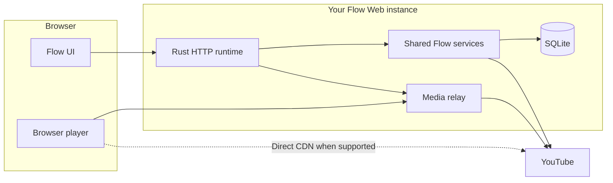

<div align="center">
  

  <h1>Flow Web</h1>

  <p><strong>Flow, wherever you have a browser.</strong></p>
  <p>A self-hosted YouTube and YouTube Music client based on <a href="https://github.com/Flow-Tube/Flow-Desktop">Flow Desktop</a>.<br>Same familiar interface. Your own server. No native app required.</p>

  <p>
    <a href="#getting-started"></a>
    <a href="https://github.com/Advancefeescam/Flow-Web/actions/workflows/web-check.yml?query=branch%3Afeat%2Fweb-runtime"></a>
    <a href="LICENSE"></a>
    <a href="https://github.com/Advancefeescam/Flow-Web/pull/1"></a>
  </p>

  [**Get started**](#getting-started) · [**Features**](#features) · [**Architecture**](#architecture) · [**Development**](#development) · [**Support Flow**](#support--donations)
</div>

> [!NOTE]
> Flow Web is an independent, unofficial port, not an official Flow release. A working experimental runtime is being developed in [PR #1](https://github.com/Advancefeescam/Flow-Web/pull/1) on the [`feat/web-runtime` branch](https://github.com/Advancefeescam/Flow-Web/tree/feat/web-runtime). The default branch does not yet contain that runtime. There is no stable web release or public hosted instance.

## Flow beyond the desktop

Flow Web brings the existing Flow interface to devices where installing Flow Desktop or Flow for Android is not possible or desirable. Run the server on a computer, home server or NAS and use it from a modern browser — including the iPad you already own.

- **No native client required.** Open your own instance on a phone, tablet or computer.
- **Your server, your library.** Keep history, preferences and recommendation data on infrastructure you control.
- **The real Flow codebase.** Reuse the original React interface and Rust services, rather than build a separate imitation.
- **Designed to complement Flow.** Native clients remain the recommended choice on supported platforms.

## Features

The experimental branch connects the original interface to a headless Rust runtime. The following reflects the implementation, not a claim of complete browser compatibility.

| Area | Web preview |
| --- | --- |
| Video | Search, watch pages, channels, comments and streaming adapters |
| YouTube Music | Browse, search, queues, lyrics and streaming adapters |
| Library | Shared SQLite storage for history, subscriptions, playlists and preferences |
| Recommendations | FlowNeuro and personalized feed adapters |
| Integrations | SponsorBlock, DeArrow and Return YouTube Dislike read adapters |
| Downloads | Browser file downloads for supported direct streams; adaptive muxing pending |
| Browser player | DASH/SABR/HLS transport, experimental direct CDN playback and local seek previews |
| Web app | Manifest and service worker; installation and device testing pending |

Flow Sync, multiple isolated profiles, complete backup/restore and native-only integrations are not yet fully ported. For detailed limitations and validation results, see the [web runtime parity tracker](https://github.com/Advancefeescam/Flow-Web/blob/feat/web-runtime/docs/WEB.md#parity-tracker).

### FlowNeuro

Flow's recommendation engine learns from viewing habits and preferences without requiring a Google account. Flow Web reuses the original recommendation services and stores their state on your own instance, rather than on the browsing device.

### Where to use it

| Browser clients | Server targets |
| --- | --- |
| Safari on iPhone and iPad | Linux x86-64 / amd64 |
| Chrome, Firefox and other modern Android browsers | Linux ARM64 / aarch64 |
| Desktop browsers on Windows, macOS and Linux | Docker or Podman on compatible Linux hosts |

These are target environments. Full playback, Safari/iPadOS and container/ARM64 compatibility still need validation.

## Getting started

The preview is intended for developers and early testers. Clone the active web branch, not the current default branch.

### Run in a container

Requires Git and Docker Compose or Podman Compose. The image is built locally from source; no official prebuilt Flow Web image is published by this project.

```sh
git clone --branch feat/web-runtime https://github.com/Advancefeescam/Flow-Web.git
cd Flow-Web
export FLOW_WEB_ORIGIN=http://127.0.0.1:8780
read -r -s -p "Instance password (at least 16 characters): " FLOW_WEB_PASSWORD; echo
export FLOW_WEB_PASSWORD
docker compose -f compose.web.yml up --build
```

For Podman, replace the final command with `podman compose -f compose.web.yml up --build`.

Open **http://127.0.0.1:8780** on the host. The server uses HTTP Basic authentication; sign in as `flow` with your configured password. The Compose configuration binds to loopback and keeps instance data in a persistent volume.

> [!IMPORTANT]
> For access from an iPad or another device, use a trusted HTTPS reverse proxy and set `FLOW_WEB_ORIGIN` to the exact external origin. Do not expose the experimental server directly to the internet. Use a separate data volume from Flow Desktop and Flow Sync.

See [deployment and development notes](https://github.com/Advancefeescam/Flow-Web/blob/feat/web-runtime/docs/WEB.md) before deploying. Container startup and remote media delivery have not been comprehensively verified.

## Architecture

Flow Web preserves the shared frontend, extraction code, streaming services and database migrations of Flow Desktop. A thin browser transport replaces Tauri IPC for web builds; the headless runtime serves the UI and exposes authenticated commands and media endpoints.



Media decoding happens on the client where supported. Direct CDN playback is experimental and can fall back to the authenticated relay. The aim is to keep web-specific changes small so future Flow Desktop releases remain easier to integrate.

## Privacy and security

Flow Web shares the privacy goals of Flow Desktop, but self-hosting changes the trust model. The operator of an instance controls the server and its stored data. Use an instance you trust, protect its credentials and use HTTPS for remote access.

Flow still contacts YouTube and optional third-party services when their features are used. Avoid sharing signed media URLs, cookies, passwords or authentication headers in logs or bug reports.

## Development

Requirements: Node.js 24, pnpm 11.9, stable Rust and the Linux build dependencies described in the [web runtime documentation](https://github.com/Advancefeescam/Flow-Web/blob/feat/web-runtime/docs/WEB.md).

From the web branch:

```sh
pnpm install --frozen-lockfile
pnpm build --mode web
export FLOW_WEB_ORIGIN=http://127.0.0.1:8780
read -r -s -p "Instance password (at least 16 characters): " FLOW_WEB_PASSWORD; echo
export FLOW_WEB_PASSWORD
cd web-server
cargo run
```

Open http://127.0.0.1:8780. For contributions, keep web-only code in `web-server/` and narrow frontend adapters wherever possible. Preserve upstream behavior for the native desktop build.

| Documentation | Purpose |
| --- | --- |
| [Web runtime](https://github.com/Advancefeescam/Flow-Web/blob/feat/web-runtime/docs/WEB.md) | Deployment, parity tracker, media testing and upstream updates |
| [Active pull request](https://github.com/Advancefeescam/Flow-Web/pull/1) | Implementation and review |
| [GitHub Actions](https://github.com/Advancefeescam/Flow-Web/actions) | Automated checks |
| [Security policy](SECURITY.md) | Private vulnerability reporting |

## The Flow project

Flow Web is made possible by [A-EDev](https://github.com/A-EDev) and the original Flow contributors. This project is not affiliated with or endorsed by the upstream project.

| Original project | Purpose |
| --- | --- |
| [Flow](https://github.com/Flow-Tube/Flow) | Native Android client |
| [Flow Desktop](https://github.com/Flow-Tube/Flow-Desktop) | Windows, macOS and Linux |
| [Flow Sync](https://github.com/Flow-Tube/Flow-Sync) | Self-hosted synchronization |
| [Flow website](https://flow-tube.org) | Official Flow ecosystem |
| [Flow community](https://www.reddit.com/r/Flow_Official/) | Community discussions |

Please keep web-port-specific feedback in this repository rather than reporting it as an upstream Flow Desktop bug.

---

<a id="support--donations"></a>
## Support & donations

If you enjoy Flow Web, consider supporting the original developer and contributors who make it possible.

<a href="https://opencollective.com/flow-tube"><picture><source media="(prefers-color-scheme: dark)" srcset="https://assets.flow-tube.org/v1/badges/pill/support-opencollective-dark.svg"></picture></a>
<a href="https://patreon.com/A_EDev"><picture><source media="(prefers-color-scheme: dark)" srcset="https://assets.flow-tube.org/v1/badges/pill/support-patreon-tonal-dark.svg"></picture></a>

## License

Flow Web is derived from Flow Desktop and licensed under the [GNU General Public License v3.0](LICENSE) (GPL-3.0-only).

Original Flow Desktop copyright © 2025–2026 A-EDev. Original attribution and copyright notices are retained.

---

<div align="center">
  <sub>Built on <a href="https://github.com/Flow-Tube/Flow-Desktop">Flow Desktop</a> · Unofficial community project · Free and open source</sub>
</div>
