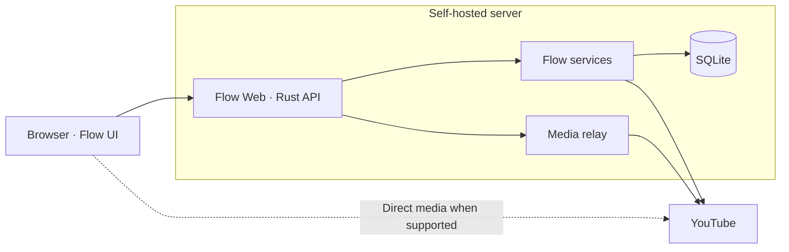

<div align="center">
  <picture>
    <source media="(prefers-color-scheme: dark)" srcset="Assets/web/banner-dark.svg">
    
  </picture>

  **A privacy-respecting YouTube and YouTube Music client, right in your browser.**

  An unofficial, self-hosted web port of [Flow Desktop](https://github.com/Flow-Tube/Flow-Desktop), built with Rust, React and TypeScript.

  <p>
  <a href="#installation"><picture><source media="(prefers-color-scheme: dark)" srcset="Assets/web/install-dark.svg"></picture></a>
  <a href="#docker--podman"><picture><source media="(prefers-color-scheme: dark)" srcset="Assets/web/server-dark.svg"></picture></a>
  <a href="#development"><picture><source media="(prefers-color-scheme: dark)" srcset="Assets/web/source-dark.svg"></picture></a>
  </p>
  <p>
  <a href="#about"><picture><source media="(prefers-color-scheme: dark)" srcset="Assets/web/platform-dark.svg"></picture></a>
  <picture><source media="(prefers-color-scheme: dark)" srcset="Assets/web/stack-dark.svg"></picture>
  <a href="LICENSE"><picture><source media="(prefers-color-scheme: dark)" srcset="Assets/web/license-dark.svg"></picture></a>
  </p>

  [**Installation**](#installation) · [**Features**](#features) · [**Original Flow**](#the-flow-project) · [**Support development**](#support--donations)
</div>

---

## About

Flow Web started because I wanted to use Flow on my iPad, where there was no native client. I also liked the idea of having a regular YouTube website experience with Flow's interface and features, without having to install an app on every device.

Instead of writing another YouTube frontend from scratch, Flow Web uses the existing Flow Desktop codebase. The React interface and Rust backend are adapted to run as a self-hosted web application.

Run Flow on a home server, NAS or computer and open it from your browser. Your library, history, settings and recommendations stay on your instance, so you can access them from different devices.

## Features

- YouTube video search and playback, channel pages, comments, Explore and Shorts.
- YouTube Music, with artists, albums, playlists, queues and lyrics.
- A personal library with subscriptions, playlists, likes, Watch Later and watch history.
- FlowNeuro recommendations without a Google account.
- SponsorBlock, DeArrow and Return YouTube Dislike integrations.
- Video and audio downloads for supported direct streams.
- Browser access on desktop and mobile, with PWA support in development.

Flow Web is under active development. Some Flow Desktop features, including Flow Sync, multiple profiles and full backup/restore, are not available in the web runtime yet. Browser and device compatibility is still being tested. See the [feature parity tracker](https://github.com/Advancefeescam/Flow-Web/blob/feat/web-runtime/docs/WEB.md#parity-tracker) for details.

### FlowNeuro

FlowNeuro is Flow's own recommendation engine. It learns from what you watch, skip, like and search for, along with your topic preferences. Flow Web reuses the original Rust engine, with recommendation data stored on your server rather than on the device you are watching from.

---

## Installation

Flow Web runs as a headless server and serves its own web interface. Docker and Podman are supported as build targets for Linux on amd64 and ARM64.

### Docker / Podman

The current web runtime is available on [`feat/web-runtime`](https://github.com/Advancefeescam/Flow-Web/tree/feat/web-runtime) while [PR #1](https://github.com/Advancefeescam/Flow-Web/pull/1) is in development. Build the image locally from source:

```bash
git clone --branch feat/web-runtime https://github.com/Advancefeescam/Flow-Web.git
cd Flow-Web

export FLOW_WEB_ORIGIN=http://127.0.0.1:8780
read -r -s -p "Password (at least 16 characters): " FLOW_WEB_PASSWORD; echo
export FLOW_WEB_PASSWORD

docker compose -f compose.web.yml up --build
```

For Podman, use `podman compose -f compose.web.yml up --build` instead.

Open **http://127.0.0.1:8780** and sign in with the username `flow` and your chosen password. The Compose file uses a persistent data volume and binds to localhost by default.

For access from other devices, put the instance behind a trusted HTTPS reverse proxy and set `FLOW_WEB_ORIGIN` to the address you use in your browser. Do not expose the development server directly to the internet or share its data volume with Flow Desktop or Flow Sync.

See [docs/WEB.md](https://github.com/Advancefeescam/Flow-Web/blob/feat/web-runtime/docs/WEB.md) for deployment notes and current compatibility limitations.

---

## How it works

The main difference between Flow Desktop and Flow Web is how the frontend communicates with the backend. Instead of running inside Tauri, the interface runs in a normal browser and communicates with a Rust HTTP server.



Most of the original Flow code is shared, including the interface, YouTube extraction, streaming services and recommendation engines. Media is decoded by the browser; direct CDN playback is being tested alongside the server relay.

The aim is to stay close to Flow Desktop so new upstream releases can be brought over without maintaining an entirely separate application.

### Privacy

No Google account is required for ordinary use. Your library and recommendation data are stored on your own instance. Flow still communicates with YouTube and optional third-party services when you use their features.

Unlike Flow Desktop, which stores data directly on your device, Flow Web stores it on the server. Only use instances you operate yourself or trust.

---

## Development

Requirements: Node.js 24, pnpm 11.9, stable Rust and the Linux build dependencies listed in [docs/WEB.md](https://github.com/Advancefeescam/Flow-Web/blob/feat/web-runtime/docs/WEB.md).

From the web runtime branch:

```bash
pnpm install --frozen-lockfile
pnpm build --mode web

export FLOW_WEB_ORIGIN=http://127.0.0.1:8780
read -r -s -p "Password (at least 16 characters): " FLOW_WEB_PASSWORD; echo
export FLOW_WEB_PASSWORD

cd web-server
cargo run
```

- [Web runtime documentation](https://github.com/Advancefeescam/Flow-Web/blob/feat/web-runtime/docs/WEB.md)
- [Updating from Flow Desktop](https://github.com/Advancefeescam/Flow-Web/blob/feat/web-runtime/docs/WEB.md#updating-from-flow-desktop)
- [Contributing](CONTRIBUTING.md)
- [Security policy](SECURITY.md)

---

## The Flow project

Flow Web is based on the work of [A-EDev](https://github.com/A-EDev) and the original Flow contributors. It is an independent fork, not an official Flow release.

If you prefer a native application or want to explore the original projects:

- [Flow for Android](https://github.com/Flow-Tube/Flow)
- [Flow Desktop](https://github.com/Flow-Tube/Flow-Desktop) — Windows, macOS and Linux
- [Flow Sync](https://github.com/Flow-Tube/Flow-Sync) — self-hosted synchronization
- [Official website](https://flow-tube.org) · [Community](https://www.reddit.com/r/Flow_Official/)

Please report problems specific to Flow Web in this repository.

---

<a id="support--donations"></a>
## Support & donations

Flow Web wouldn't exist without the original Flow project. If you enjoy using it, consider supporting A-EDev and the upstream development of Flow.

<a href="https://opencollective.com/flow-tube"><picture><source media="(prefers-color-scheme: dark)" srcset="https://assets.flow-tube.org/v1/badges/pill/support-opencollective-dark.svg"></picture></a>
<a href="https://patreon.com/A_EDev"><picture><source media="(prefers-color-scheme: dark)" srcset="https://assets.flow-tube.org/v1/badges/pill/support-patreon-tonal-dark.svg"></picture></a>

## License

Flow Web is free and open-source software licensed under the [GNU General Public License v3.0](LICENSE) (GPL-3.0-only).

Original Flow Desktop copyright © 2025–2026 A-EDev.

Modified for browser and server use by Flow Web contributors, November 2026.
